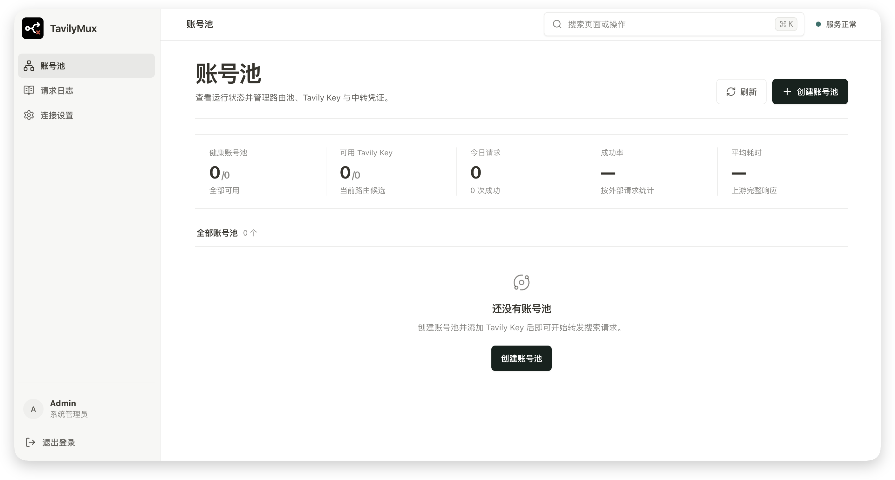

<div align="center">
  
</div>
<div align="center">
  
</div>
<p align="center"><strong>A high-performance, self-hosted Tavily key pool and transparent API gateway</strong></p>
<p align="center">
  <a href="https://github.com/tropical-algae/TavilyMux/actions/workflows/ci.yaml"></a>
  <a href="https://github.com/tropical-algae/TavilyMux/actions/workflows/release.yaml"></a>
  <a href="README_CN.md"></a>
  <a href="LICENSE"></a>
</p>

TavilyMux organizes multiple Tavily keys into isolated account pools and provides a unified gateway compatible with Tavily Search, Extract, Crawl, Map, Research, and Feedback APIs.

The service selects an available key according to each pool's routing policy, performs controlled failover when an upstream request fails, and includes quota monitoring, request logs, and a Web management console.



## Features

- **Multiple account pools**: Configure multiple isolated pools, each with its own routing policy, connection settings, and relay credentials.
- **Transparent Tavily API relay**: Forward request bodies, query strings, headers, status codes.
- **Extensible endpoint registry**: Disable built-in endpoints or register future stateless GET/POST endpoints through configuration.
- **In-memory routing**: Choose between two routing strategies.
- **Failover**: Cool down or disable unhealthy keys according to the upstream error type, then select another available key when permitted.
- **Quota monitoring**: Periodically query Tavily Usage and display key-level and account-level quotas.
- **Observability**: Record request outcomes, internal attempts, latency, and key usage.
- **Proxy support**: Configure global or pool-level HTTP/HTTPS proxies, including services such as Clash.
- **Secure storage**: Encrypt Tavily keys and proxy credentials while storing only hashes or digests of management and relay keys.

## Getting Started

<details>

<summary><strong>🐳 Docker Setup</strong> - Click to expand</summary>

</br>

Create a persistent data directory and start the container:

```bash
mkdir -p data

docker run -d \
  --name tavilymux \
  --restart unless-stopped \
  -p 8080:8080 \
  -v "$(pwd)/data:/data" \
  -e TAVILY_MUX_ADMIN_SECRET='an administration key of at least 12 characters' \
  tropicalalgae/tavilymux:latest
```

</details>

<details>

<summary><strong>📦 Docker Compose Setup</strong> - Click to expand</summary>

</br>

```bash
mkdir -p data
docker compose up -d --build
```

Compose runs a standalone Nginx instance in front of TavilyMux, with Nginx exposing the service port.

Nginx handles Gzip compression, timeouts, and streaming response buffering policy, but it is not a functional dependency of TavilyMux.

When the application image is run on its own, the Web console and all APIs remain fully available. If your deployment already uses Caddy, Traefik, Nginx, or a cloud gateway, you can use the Docker setup directly.

</details>

> [!IMPORTANT]
> `TAVILY_MUX_ADMIN_SECRET` is used only to initialize the management key on first startup.
> If it is not configured, TavilyMux generates a random management key and prints it in the logs.


The TavilyMux Web console, management API, and API relay share port `8080`. Once the service is running, open [`http://localhost:8080`](http://localhost:8080).

To call the relay, replace the official Tavily base URL `https://api.tavily.com` with your TavilyMux URL and use the pool relay key in `Authorization: Bearer <relay-key>`. Request parameters and response formats remain unchanged.

| Endpoint                          | Method | Description                         |
| --------------------------------- | ------ | ----------------------------------- |
| `/search`                         | `POST` | Search and return organized results |
| `/extract`                        | `POST` | Extract content from given pages    |
| `/crawl`                          | `POST` | Crawl site pages and content        |
| `/map`                            | `POST` | Discover and map site links         |
| `/research`                       | `POST` | Create or stream a research task    |
| `/research/{request_id}`          | `GET`  | Retrieve a research task result     |
| `/feedback`                       | `POST` | Submit feedback for a request       |

## Configuration

TavilyMux loads configuration in this order: environment variables, `.env`, `config.yaml`, then application defaults. See [.env.example](.env.example) and [config.yaml.example](config.yaml.example) for complete examples.

The table lists application defaults. The official Docker image overrides `DATA_DIR`, `WEB_ROOT`, and `TAVILY_MUX_CONFIG_FILE` with `/data`, `/app/web`, and `/data/config.yaml`, respectively.

| YAML field                              | Environment variable                            | Default                                 | Description                                      |
| --------------------------------------- | ----------------------------------------------- | --------------------------------------- | ------------------------------------------------ |
| `HOST`                                  | `TAVILY_MUX_HOST`                               | `0.0.0.0`                               | Listen address                                   |
| `PORT`                                  | `TAVILY_MUX_PORT`                               | `8080`                                  | Listen port                                      |
| `DATA_DIR`                              | `TAVILY_MUX_DATA_DIR`                           | `./data`                                | Storage directory for data and generated secrets |
| `DATABASE_URL`                          | `TAVILY_MUX_DATABASE_URL`                       | Empty; uses `<DATA_DIR>/database.db`    | Database connection URL                          |
| `WEB_ROOT`                              | `TAVILY_MUX_WEB_ROOT`                           | Empty                                   | Directory containing built Web assets            |
| `AUTO_MIGRATE`                          | `TAVILY_MUX_AUTO_MIGRATE`                       | `true`                                  | Run database migrations on startup               |
| `LOG_LEVEL`                             | `TAVILY_MUX_LOG_LEVEL`                          | `INFO`                                  | Logging level                                    |
| `LOG_FORMAT`                            | `TAVILY_MUX_LOG_FORMAT`                         | `text`                                  | Log format: `text` or `json`                     |
| `ACCESS_LOG`                            | `TAVILY_MUX_ACCESS_LOG`                         | `false`                                 | Emit HTTP access logs                            |
| `ADMIN_SECRET`                          | `TAVILY_MUX_ADMIN_SECRET`                       | Empty; generated on first startup       | Initial management key; at least 12 characters   |
| `MASTER_KEY`                            | `TAVILY_MUX_MASTER_KEY`                         | Empty; generated in `<DATA_DIR>/master.key` | Master key for encrypted credentials          |
| `COOKIE_SECURE`                         | `TAVILY_MUX_COOKIE_SECURE`                      | `false`                                 | Send the session cookie only over HTTPS          |
| `COOKIE_SAMESITE`                       | `TAVILY_MUX_COOKIE_SAMESITE`                    | `lax`                                   | Session cookie SameSite policy                   |
| `SESSION_MAX_AGE_SECONDS`               | `TAVILY_MUX_SESSION_MAX_AGE_SECONDS`            | `86400`                                 | Login session lifetime in seconds                |
| `EVENT_QUEUE_SIZE`                      | `TAVILY_MUX_EVENT_QUEUE_SIZE`                   | `10000`                                 | Asynchronous event queue capacity                |
| `GLOBAL_MAX_CONCURRENCY`                | `TAVILY_MUX_GLOBAL_MAX_CONCURRENCY`             | `2000`                                  | Maximum concurrency per instance                 |
| `MAX_REQUEST_BODY_BYTES`                | `TAVILY_MUX_MAX_REQUEST_BODY_BYTES`             | `10485760`                              | Maximum relay request body size in bytes         |
| `UPSTREAM_MAX_CONNECTIONS`              | `TAVILY_MUX_UPSTREAM_MAX_CONNECTIONS`           | `2000`                                  | Maximum upstream connections                     |
| `UPSTREAM_MAX_KEEPALIVE_CONNECTIONS`    | `TAVILY_MUX_UPSTREAM_MAX_KEEPALIVE_CONNECTIONS` | `500`                                   | Maximum upstream keep-alive connections          |
| `USAGE_CHECK_CONCURRENCY`               | `TAVILY_MUX_USAGE_CHECK_CONCURRENCY`            | `10`                                    | Maximum quota-check task concurrency             |
| `ENDPOINTS`                             | `TAVILY_MUX_ENDPOINTS`                          | `{"DISABLED":[],"CUSTOM":[]}`        | Built-in disable list and custom endpoint registry |
| —                                       | `TAVILY_MUX_CONFIG_FILE`                        | `./config.yaml`                         | YAML configuration path; environment-only        |

`ENDPOINTS.CUSTOM` entries require only a `PATH`; `METHOD` defaults to `POST` and may also be `GET`. Custom endpoints are stateless and cannot use path parameters. A path is unique across the registry, so the same path conflicts even when its HTTP method differs. See [config.yaml.example](config.yaml.example) for the compact structure.

If the management key is lost, generate a new one and revoke all existing login sessions:

```bash
# Docker deployment:
docker exec -it tavilymux tavily-mux reset-admin-secret
# Compose deployment:
docker compose run --rm app reset-admin-secret
```

## Local Development

Local development requires Python 3.13, uv, Node.js 24, and npm.
See the [local development guide](docs/en/development.md) for dependency installation, backend and frontend startup, testing, and build instructions.

## Current Limitations

- [x] Support Tavily Extract, Crawl, Map, and Research endpoints in addition to Search.
- [ ] Support multiple Uvicorn workers or replicas; routing state, concurrency control, and key cooldown state currently live in the memory of a single instance.
- [ ] Support external persistent databases such as PostgreSQL.
- [ ] ~~Support multiple administrators, role-based access control, and isolated management spaces; the service currently uses a single management key.~~
- [ ] Provide integrated backup and restore tooling for account pools, configuration, and encrypted data.
- [ ] Provide Prometheus metrics, OpenTelemetry traces, and more comprehensive runtime alert integrations.
- [ ] Provide built-in HTTPS certificate management; TLS should currently be terminated by Nginx, Caddy, Traefik, or a cloud gateway.

## License

TavilyMux is released under the [MIT License](LICENSE).
