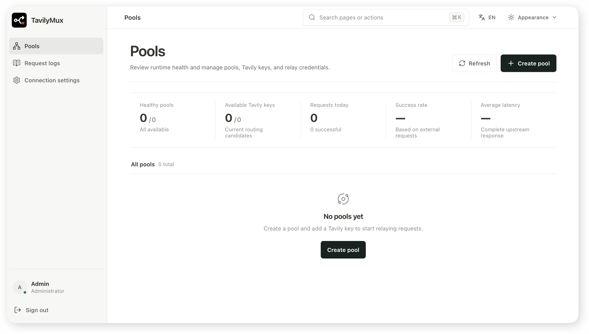

<div align="center">
  <picture>
    <source media="(prefers-color-scheme: dark)" srcset="web/public/tavily-mux-dark.svg" />
    <source media="(prefers-color-scheme: light)" srcset="web/public/tavily-mux.svg" />
    
  </picture>
</div>
<div align="center">
  <picture>
    <source media="(prefers-color-scheme: dark)" srcset="web/public/tavily-mux-name-dark.svg" />
    <source media="(prefers-color-scheme: light)" srcset="web/public/tavily-mux-name.svg" />
    
  </picture>
</div>
<p align="center"><strong>高性能、自托管的 Tavily Key 池与透明 API 网关</strong></p>
<p align="center">
  <a href="https://github.com/tropical-algae/TavilyMux/actions/workflows/ci.yaml"></a>
  <a href="https://github.com/tropical-algae/TavilyMux/actions/workflows/release.yaml"></a>
  <a href="README.md"></a>
  <a href="LICENSE"></a>
</p>

TavilyMux 将多个 Tavily Key 组织成相互隔离的账号池，并提供兼容 Tavily Search、Extract、Crawl、Map、Research 与 Feedback 接口的统一网关

服务会按池内规则选择可用 Key，在上游请求失败时执行受控切换，同时提供额度监控、请求日志和 Web 管理控制台

<div align="center">
  <picture>
    <source media="(prefers-color-scheme: dark)" srcset="docs/assert/preview-cn-dark.png" />
    <source media="(prefers-color-scheme: light)" srcset="docs/assert/preview-cn-light.png" />
    
  </picture>
</div>

## 特性说明

- **多账号池**：支持配置多个隔离的账号池，拥有独立的路由规则、连接配置和中转凭证
- **透明 Tavily API 中转**：原样转发请求体、查询参数、请求头、状态码与响应
- **可扩展接口注册**：可通过配置禁用内置接口，或注册未来新增的无状态 GET/POST 接口
- **内存路由**：支持2种路由策略
- **故障切换**：根据上游错误类型冷却或停用异常 Key，并在允许的范围内选择其他可用 Key
- **额度监控**：定期读取 Tavily Usage，展示 Key 与账户额度
- **可观测性**：记录请求结果、内部尝试、耗时和 Key 使用情况
- **代理支持**：支持全局或账号池级 HTTP/HTTPS 代理，可连接 Clash 等代理服务
- **安全存储**：Tavily Key 和代理凭据加密保存，管理密钥和中转 Key 仅保存哈希或摘要

## 快速开始


<details>

<summary><strong>🐳 Docker Setup</strong> - Click to expand</summary>

</br>

准备一个持久化目录，然后启动容器：

```bash
mkdir -p data

docker run -d \
  --name tavilymux \
  --restart unless-stopped \
  -p 8080:8080 \
  -v "$(pwd)/data:/data" \
  -e TAVILY_MUX_ADMIN_SECRET='至少 12 位的管理密钥' \
  tropicalalgae/tavilymux:latest
```

</details>

<details>

<summary><strong>📦 Docker Compose Setup</strong> - Click to expand</summary>

</br>

```bash
mkdir -p data
docker compose up -d --build
```

Compose 会在 TavilyMux 前运行一个独立的 Nginx，并由 Nginx 暴露服务端口

Nginx 负责 Gzip、超时和流式响应缓冲策略，但不是 TavilyMux 的功能依赖

单独运行应用镜像时，Web 控制台和所有 API 仍然完整可用。如果部署环境已经有 Caddy、Traefik、Nginx 或云端网关，可以直接使用 Docker Run 方式

</details>

> [!IMPORTANT]
> `TAVILY_MUX_ADMIN_SECRET` 只用于首次初始化管理密钥
> 如果首次启动时未配置，TavilyMux 会随机生成一个管理密钥，并在日志中显示

TavilyMux 的 Web 控制台、管理 API 和 API 中转默认 `8080` 端口。启动后访问 `http://localhost:8080` 登录后台

调用时，将 Tavily 官方地址 `https://api.tavily.com` 替换为 TavilyMux 地址，并在 `Authorization: Bearer <中转 Key>` 中使用账号池生成的中转 Key。请求参数与响应格式保持不变

| 接口                              | 类型   | 描述                   |
| --------------------------------- | ------ | ---------------------- |
| `/search`                         | `POST` | 搜索并返回整理后的结果 |
| `/extract`                        | `POST` | 提取指定网页内容       |
| `/crawl`                          | `POST` | 爬取站点页面与内容     |
| `/map`                            | `POST` | 发现并映射站点链接     |
| `/research`                       | `POST` | 创建研究任务或流式研究 |
| `/research/{request_id}`          | `GET`  | 查询研究任务结果       |
| `/feedback`                       | `POST` | 提交请求结果反馈       |

## 配置方法

TavilyMux 按“环境变量 → `.env` → `config.yaml` → 应用默认值”的优先级加载配置。配置示例见 [.env.example](.env.example) 和 [config.yaml.example](config.yaml.example)

下表为应用默认值。官方 Docker 镜像会将 `DATA_DIR`、`WEB_ROOT` 和 `TAVILY_MUX_CONFIG_FILE` 分别设为 `/data`、`/app/web` 和 `/data/config.yaml`

| YAML 字段                               | 环境变量                                        | 默认值                                  | 说明                                          |
| --------------------------------------- | ----------------------------------------------- | --------------------------------------- | --------------------------------------------- |
| `HOST`                                  | `TAVILY_MUX_HOST`                               | `0.0.0.0`                               | 监听地址                                      |
| `PORT`                                  | `TAVILY_MUX_PORT`                               | `8080`                                  | 监听端口                                      |
| `DATA_DIR`                              | `TAVILY_MUX_DATA_DIR`                           | `./data`                                | 数据与自动生成主密钥的存储目录                |
| `DATABASE_URL`                          | `TAVILY_MUX_DATABASE_URL`                       | 空，使用 `<DATA_DIR>/database.db`       | 数据库连接地址                                |
| `WEB_ROOT`                              | `TAVILY_MUX_WEB_ROOT`                           | 空                                      | 已构建 Web 静态文件目录                       |
| `AUTO_MIGRATE`                          | `TAVILY_MUX_AUTO_MIGRATE`                       | `true`                                  | 启动时自动执行数据库迁移                      |
| `LOG_LEVEL`                             | `TAVILY_MUX_LOG_LEVEL`                          | `INFO`                                  | 日志级别                                      |
| `LOG_FORMAT`                            | `TAVILY_MUX_LOG_FORMAT`                         | `text`                                  | 日志格式，可选 `text` 或 `json`               |
| `ACCESS_LOG`                            | `TAVILY_MUX_ACCESS_LOG`                         | `false`                                 | 是否输出 HTTP 访问日志                        |
| `ADMIN_SECRET`                          | `TAVILY_MUX_ADMIN_SECRET`                       | 空，首次启动时随机生成                  | 首次初始化使用的登录管理密钥，至少 12 位      |
| `MASTER_KEY`                            | `TAVILY_MUX_MASTER_KEY`                         | 空，在 `<DATA_DIR>/master.key` 自动生成 | 加密 Tavily Key 与代理凭据的主密钥            |
| `COOKIE_SECURE`                         | `TAVILY_MUX_COOKIE_SECURE`                      | `false`                                 | 是否仅通过 HTTPS 发送会话 Cookie              |
| `COOKIE_SAMESITE`                       | `TAVILY_MUX_COOKIE_SAMESITE`                    | `lax`                                   | 会话 Cookie 的 SameSite 策略                  |
| `SESSION_MAX_AGE_SECONDS`               | `TAVILY_MUX_SESSION_MAX_AGE_SECONDS`            | `86400`                                 | 登录会话有效期，单位为秒                      |
| `EVENT_QUEUE_SIZE`                      | `TAVILY_MUX_EVENT_QUEUE_SIZE`                   | `10000`                                 | 异步事件队列容量                              |
| `GLOBAL_MAX_CONCURRENCY`                | `TAVILY_MUX_GLOBAL_MAX_CONCURRENCY`             | `2000`                                  | 单实例允许的全局并发数                        |
| `MAX_REQUEST_BODY_BYTES`                | `TAVILY_MUX_MAX_REQUEST_BODY_BYTES`             | `10485760`                              | 中转请求体大小上限，单位为字节                |
| `UPSTREAM_MAX_CONNECTIONS`              | `TAVILY_MUX_UPSTREAM_MAX_CONNECTIONS`           | `2000`                                  | 上游连接池最大连接数                          |
| `UPSTREAM_MAX_KEEPALIVE_CONNECTIONS`    | `TAVILY_MUX_UPSTREAM_MAX_KEEPALIVE_CONNECTIONS` | `500`                                   | 上游连接池最大长连接数                        |
| `USAGE_CHECK_CONCURRENCY`               | `TAVILY_MUX_USAGE_CHECK_CONCURRENCY`            | `10`                                    | 额度检测任务最大并发数                        |
| `ENDPOINTS`                             | `TAVILY_MUX_ENDPOINTS`                          | `{"DISABLED":[],"CUSTOM":[]}`        | 内置接口禁用列表与自定义接口注册              |
| —                                       | `TAVILY_MUX_CONFIG_FILE`                        | `./config.yaml`                         | YAML 配置文件路径，仅通过环境变量设置         |

`ENDPOINTS.CUSTOM` 每项只要求填写 `PATH`，`METHOD` 默认为 `POST`，也可设为 `GET`。自定义接口按无状态接口处理，暂不支持路径参数。注册表中的路径全局唯一，因此即使 Method 不同，同一路径也会冲突。简化结构见 [config.yaml.example](config.yaml.example)

如果遗失管理密钥，可以生成新密钥并撤销已有登录会话：

```bash
# Docker 部署：
docker exec -it tavilymux tavily-mux reset-admin-secret
# Compose 部署：
docker compose run --rm app reset-admin-secret
```

## 本地开发

本地开发需要 Python 3.13、uv、Node.js 24 和 npm
依赖安装、前后端启动、测试和构建方式见[本地开发指南](docs/cn/development.md)

## 当前局限

- [x] 支持除 Search 之外的 Tavily Extract、Crawl、Map 和 Research 接口
- [ ] 支持多个 Uvicorn Worker 或多副本部署；当前路由状态、并发控制和 Key 冷却状态保存在单实例内存中
- [ ] 支持 PostgreSQL 等外部持久化数据库
- [ ] ~~支持多管理员、角色权限和相互隔离的管理空间；当前服务使用单一管理密钥~~
- [ ] 提供账号池、配置和加密数据的一体化备份与恢复工具
- [ ] 提供 Prometheus 指标、OpenTelemetry Trace 和更完整的运行告警集成
- [ ] 内置 HTTPS 证书管理；当前应由 Nginx、Caddy、Traefik 或云端网关终止 TLS

## 许可证

TavilyMux 使用 [MIT License](LICENSE) 发布。
